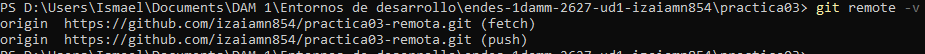
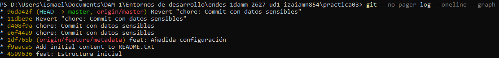

# Práctica 3: Git y repositorios remotos

## Descripción
En esta práctica he trabajado con repositorios remotos, sincronización de cambios, ramas y corrección de errores utilizando Git desde la terminal.

## Comandos utilizados
- `git remote -v`: comprobar los repositorios remotos.
- `git push`: subir cambios a GitHub.
- `git fetch` y `git pull`: descargar cambios del repositorio remoto.
- `git merge`: fusionar ramas.
- `git revert`: deshacer cambios publicados.
- `git branch`: gestionar ramas.

## Capturas

- `git remote -v`

La captura muestra el resultado de git remote -v, donde se puede comprobar la dirección del repositorio remoto de GitHub.
- `git log --oneline --graph`

La captura muestra el resultado de git log --oneline --graph, que permite visualizar el historial de commits y las ramas del repositorio.